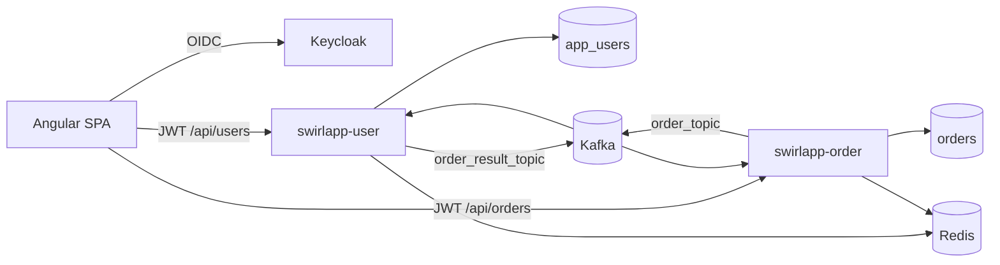
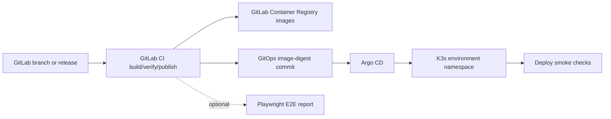

# Architecture Overview And ADR Index

This directory contains Swirl Demo App architecture decision records. ADRs explain why the template demonstrates a pattern, where its boundary is, and what future changes must preserve or deliberately replace.

## System Architecture At A Glance



Delivery:



## Service Architecture

`swirlapp-common` contains only cross-cutting contracts and infrastructure:

- auditing base/configuration
- `OrderStatus` and `OrderEvent`
- Kafka topics/retry/DLT wiring
- Problem Details handling
- request-ID, request-size, and rate-limit filters

Each deployable service owns:

- controller: HTTP mapping
- DTO: supported request/response contract
- service/listener: transactions, orchestration, and event state
- repository: persistence access
- domain: service-owned JPA entity
- config: caching, health, and security
- resources: profiles, logging, migrations, and local seed SQL

Service-owned entities do not live in the shared module. Services share an event contract, not repositories or direct database access.

ArchUnit tests enforce these boundaries in every build; see the [testing guide](testing.md#backend-test-map). A new service adds one `*ArchitectureTest` that includes the shared `ArchitectureRules`.

## Frontend Architecture

`swirlapp-web` is a standalone Angular application with:

- lazy route components for login, users, and orders
- functional routing, auth guard, and HTTP interceptor
- typed API service/model pairs
- observable authentication and notification state
- relative `/api` routing and canonical public Keycloak authentication
- Vitest at the unit/component layer
- Playwright for critical cross-system journeys
- unprivileged NGINX production runtime

The UI stays deliberately small so infrastructure and delivery behavior remain visible.

## Key Runtime Lifecycles

### Authenticated API request

1. Angular loads Keycloak OIDC discovery.
2. Authorization Code + PKCE authenticates the browser.
3. The interceptor adds the access token to an API request.
4. the request-ID filter validates or creates `X-Request-Id`.
5. the request-size filter rejects a body over 64 KB with `413` (a chunked form or multipart body with `411`).
6. Spring Security validates the JWT issuer/signature/time claims.
7. the rate limiter accounts by principal.
8. controller validates DTO/path/query values.
9. service executes a transaction and repository/cache work.
10. response DTO hides persistence-only fields.
11. logs and errors carry the request ID.

### Order creation and validation

1. authenticated caller creates an order.
2. `swirlapp-order` persists it as `PENDING`.
3. when messaging is enabled, the same transaction records a keyed `OrderEvent` in the `order_outbox` table, and `OutboxRelay` publishes it to `order_topic` within about a second.
4. `swirlapp-user` resolves the user.
5. missing user becomes a normal `REJECTED` result; transient failures propagate for retry.
6. `swirlapp-user` awaits result publication to `order_result_topic`.
7. `swirlapp-order` validates identifiers, status, and current state.
8. exact duplicates are ignored; a pending order becomes approved or rejected.
9. affected cache data is evicted.

The order change and its event commit together; publication is at least once ([ADR 0011](./adr/0011-transactional-outbox.md)).

### Deployment

One shared GitLab project builds integration snapshots and immutable releases.
`int` accepts any branch; `uat` and `prod` require a finalized release. Central
Argo CD reconciles that environment's pinned revision in its registered namespace,
on the shared cluster or an optional remote cluster. Each environment consumes
separate credentials and logical data resources from the shared platform. See the
[delivery flow](deployment.md#delivery-flow) for publication, promotion and health
checks, and [code quality](code-quality.md) for analysis ownership and discovery scope.

## Cache Behavior

Each service caches single-record reads in Redis (`users`, `orders`) for the `uat` and `prod` profiles; other profiles use an in-memory or no cache.

- **Outages fail open.** `FailOpenCacheErrorHandler` turns every cache failure (unreachable Redis, timeout, an entry that no longer deserializes) into a logged miss, so the request is served from PostgreSQL. Redis is never a readiness dependency.
- **Stampedes are bounded per pod.** Cached reads use `@Cacheable(sync = true)`, so concurrent misses for one key load it once per instance.
- **Writes evict.** Creates, edits and deletes evict the whole cache name, and an order result evicts that order. Entries also expire after 10 minutes.
- **Keys are versioned.** Keys look like `<REDIS_CACHE_PREFIX><cache>:<version>::<id>`, for example `swirl-demo-app:prod:users:v1::7`. Bump `CacheConfig.CACHE_VERSION` when the cached entity changes shape, so new pods never read values written by old ones during a rolling deployment.
- **Staleness is bounded by the TTL.** If an eviction fails (Redis down during a write), another pod can serve the old value until the entry expires. That is acceptable for this demo's profile data; data that must never be stale should not be cached or needs a shorter TTL.

## Hypermedia Example

`GET /api/orders/{id}` with `Accept: application/prs.hal-forms+json` returns the order with `_links` (`self`, `orders`, and `user`, which points across to the user service) and `_templates` describing the requests the server accepts: `updateOrder` (`PUT` with required `userId` and `productId`) and `deleteOrder`. Any other `Accept` value gets the plain JSON every client uses today. `OrderHypermedia` builds the representation; `OrderApiHttpTest` pins it.

Level 3 is worth its coupling when clients should discover what they may do next from the server, for example when actions depend on state or permissions the client cannot compute, or when many independent clients must follow server-side workflow changes without a release. It costs a hypermedia-aware client, larger responses, and links that must stay stable. This demo's single Angular client knows its workflow, so it keeps using plain JSON.

OpenAPI and hypermedia answer different questions. The OpenAPI document describes every operation at design time for code generation and review; HAL-FORMS templates describe the operations available on one resource at run time. Keep the OpenAPI document authoritative for the contract; the templates must never offer an operation it does not describe.

## Data Ownership Rules

- `swirlapp-user` owns `app_users`.
- `swirlapp-order` owns `orders`.
- `orders.user_id` is a logical reference, not a foreign key.
- services do not query one another's repositories/tables.
- Kafka performs cross-service validation.
- both services may share a PostgreSQL schema operationally while keeping separate Flyway histories.
- Redis values are disposable caches.
- Keycloak owns credentials and authentication identity.

## Template Constraints

- Product behavior stays minimal and subordinate to reusable technical examples.
- Optional infrastructure must not make the fast default profile difficult to run.
- Failure behavior, operations, tests, and removal points are part of each reusable pattern.
- Distributed patterns are introduced only with a demonstrable failure mode.
- Documentation must distinguish current implementation from roadmap direction.

## ADR Process

Add an ADR when a change:

- changes service or frontend boundaries
- changes data/event ownership or compatibility
- introduces a material runtime dependency
- changes authentication, authorization, privacy, or secret flow
- changes transaction/retry/idempotency guarantees
- changes delivery or operational ownership
- constrains how template adopters can extend/remove a capability

Use the next sequence number:

```text
NNNN-short-title.md
```

Statuses:

- **Proposed**: under review, not a stable template decision
- **Accepted**: current direction
- **Superseded**: retained for history and linked to replacement

## Accepted ADRs

- [ADR 0001: Split Detailed Documentation Out Of The Root README](./adr/0001-documentation-structure.md)
- [ADR 0002: Keep A Minimal Domain Across Two Independently Deployable Services](./adr/0002-minimal-domain-microservices.md)
- [ADR 0003: Use The Java, Angular, And Shared Platform Stack](./adr/0003-platform-stack-and-profiles.md)
- [ADR 0004: Coordinate Services Asynchronously Through Kafka](./adr/0004-kafka-event-coordination.md)
- [ADR 0005: Delegate Authentication To Keycloak And Validate JWTs At Each API](./adr/0005-keycloak-jwt-security.md)
- [ADR 0006: Use Service-Owned Flyway Histories In The Shared PostgreSQL Schema](./adr/0006-service-owned-flyway.md)
- [ADR 0007: Deliver Through GitLab CI, Immutable Images, And Argo CD](./adr/0007-gitlab-ci-argocd-gitops.md)
- [ADR 0008: Keep Verification Layered And Continuous](./adr/0008-code-quality-and-verification.md)
- [ADR 0009: Use Explicit Delivery Jobs And Non-Blocking Verification](./adr/0009-explicit-delivery-jobs.md)
- [ADR 0010: Trace Through Micrometer Observation With The OpenTelemetry Bridge](./adr/0010-opentelemetry-tracing.md)
- [ADR 0011: Publish Order Events Through A Polling Transactional Outbox](./adr/0011-transactional-outbox.md)
- [ADR 0012: Version Order Events By Major Schema Version And Evolve Them Additively](./adr/0012-event-schema-compatibility.md)
- [ADR 0013: Keep The Template And Generated Code Under GPL 3.0](./adr/0013-gpl-license.md)
- [ADR 0014: Treat The Template As The Product, For Teams Facing Regulated Reviews](./adr/0014-template-scope-and-audience.md)

## Proposed ADRs For Roadmap Work

Create decisions before implementing:

- HTTP resilience reference adapter
- distributed rate limiting at the gateway or Redis layer
- consumer-driven contract testing for service and event contracts
- envelope encryption and key rotation
- per-environment replica and resource sizing (Kustomize or Helm), and which environments run the canary overlay
- shared internal Spring starters versus copyable source modules

## ADR Template

```markdown
# ADR NNNN: Title

- Status: Proposed | Accepted | Superseded
- Date: YYYY-MM-DD

## Context

What forces, constraints, and current facts made this decision necessary?

## Decision

What did we decide?

## Rationale

Why this option over the alternatives?

## Consequences

What becomes easier, harder, riskier, or more constrained?
```

## Related Guides

- [Features](./features.md)
- [Data Model](./data-model.md)
- [Development](./development.md)
- [Testing](./testing.md)
- [Code Quality](./code-quality.md)
- [Deployment](./deployment.md)
- [Operations](./operations.md)
- [Security](./security.md)
