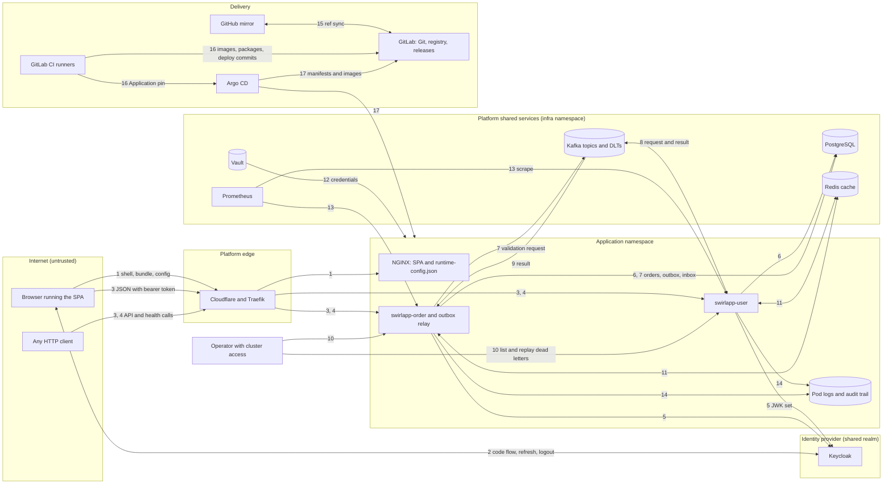

# Threat Model

This is a STRIDE threat model of Swirl Demo App's reference flow (the SPA, the user and order APIs, PostgreSQL, the Kafka validation round trip and the Redis cache) and of the delivery path that builds and deploys it.
[Security Reference](security.md) describes the controls; this document asks what each element is exposed to, which control answers it, and where the code and the test that prove it live.
It was reviewed on 2026-10-23 against release 1.13.0.

## Scope And Method

The model starts from the data-flow diagram below and applies STRIDE (Spoofing, Tampering, Repudiation, Information disclosure, Denial of service, Elevation of privilege) to each element and flow.
Every control listed was checked against the code it links to, and a test is named where one pins the control.

Platform-owned services are external entities: the Cloudflare zone, the shared Keycloak realm's policies, Kafka ACLs, Vault policies, runner protection and admission control live in `swirl-cloud`.
A threat that depends on them says so rather than counting them as controls.

Each threat has a status:

- **Mitigated:** controls in this repository answer the threat; the note says what risk is left.
- **Partial:** controls reduce the threat and a named gap remains.
- **Open:** nothing in this repository answers it yet.

Each Partial or Open row says where its gap is tracked: an existing roadmap section or security limitation, an entry under [TODO.md › Bugs to fix](../TODO.md#bugs-to-fix) that starts with the row's ID, or the platform question in [TODO.md › Needs Input](../TODO.md#needs-input).

## Data-Flow Diagram

### Flows

| Flow | From and to | Data | Protection | Capability |
| --- | --- | --- | --- | --- |
| 1 | Browser to Cloudflare and Traefik to NGINX | SPA shell, bundle, `runtime-config.json` | HTTPS to the edge | Web UI |
| 2 | Browser and Keycloak | Authorization code with PKCE, tokens, refresh, logout | HTTPS | Keycloak and Web UI |
| 3 | Browser or any client to Traefik to the APIs | User and order JSON with a bearer token | HTTPS to the edge, HTTP inside the cluster | Core |
| 4 | Anyone to `/health/user` and `/health/order` | Health status | HTTPS to the edge | Core |
| 5 | APIs to Keycloak | JWK set | HTTPS in the committed environments | Keycloak |
| 6 | APIs to PostgreSQL | Users, orders, outbox, inbox | Password login, no TLS enforced | Core |
| 7 | Order service to `order_outbox` to `order_topic` | Validation request with its trace context | Same transaction as the order change; SASL SCRAM without TLS | Kafka |
| 8 | `order_topic` to the user service to `order_result_topic` | Request, then the result with the resolved user name | SASL SCRAM without TLS | Kafka |
| 9 | `order_result_topic` to the order service to `orders` and `order_inbox` | Result | SASL SCRAM without TLS | Kafka |
| 10 | Operator to `/actuator/deadletters` to a DLT and back to its source topic | Dead-letter listing and replay | Bearer token; reachable by port-forward, not the ingress | Kafka |
| 11 | APIs and Redis | Cached users and orders | ACL user, no TLS | Redis |
| 12 | Vault to External Secrets to a Secret to pod environment | Database, Kafka and Redis credentials | One store per environment | Delivery |
| 13 | Prometheus to `/actuator/prometheus` | Metrics | None inside the cluster | Core |
| 14 | APIs to pod stdout | JSON logs and audit entries | Node-local files | Core |
| 15 | GitHub and GitLab | Branches and tags, the push webhook | HTTPS with sync tokens | Delivery |
| 16 | CI runners to GitLab, the registry and the cluster | Images, packages, deploy commits, Argo CD Applications | Job tokens, over HTTP inside the cluster | Delivery |
| 17 | Argo CD to GitLab, nodes to the registry | Manifests by commit, images by digest | Commit and digest pinning, over HTTP | Delivery |

### Trust Boundaries

- The internet and the platform edge (flows 1, 3 and 4).
- The browser and the identity provider (flow 2).
- The application namespace and the shared services in `infra`, which int, uat and prod all use (flows 6 to 13).
- Prod's `apps` namespace, which prod shares with the platform's other applications ([Ownership And Topology](deployment.md#ownership-and-topology)).
- GitHub and GitLab (flow 15), and the CI runners and the cluster (flow 16).

## Assets

- Access, ID and refresh tokens.
- Personal data: name, username and email, plus the user name copied onto orders, results and dead letters.
- Order state and its validation outcome.
- The audit trail.
- Runtime credentials for PostgreSQL, Kafka and Redis.
- Delivery credentials: sync tokens, CI job tokens, the registry deploy token, `SONAR_TOKEN` and Vault tokens.
- Release integrity: images, packages, tags, manifests and deploy records.
- Availability of the reference flow.

## Threats

### Core: HTTP APIs, Data And Audit

These rows apply to every project: the user and order APIs, their filters, Actuator, PostgreSQL and the audit trail.

| ID | Element | STRIDE | Threat | Controls and evidence | Status |
| --- | --- | --- | --- | --- | --- |
| C1 | Profile defaults | E | A Deployment that loses `SPRING_PROFILES_ACTIVE=prod` starts in the image default `dev` profile, where security and `@PreAuthorize` are off, the H2 console is on and request bodies are logged. | Both Deployments set the prod profile ([user.yaml](../infra/k8s/user.yaml), [order.yaml](../infra/k8s/order.yaml)), and the `uat`/`prod` profile forces security, rate limiting and Flyway on ([application.yml](../swirlapp-user/src/main/resources/application.yml)). | **Partial**: insecure by default, and [check-manifest-policy.py](../infra/scripts/check-manifest-policy.py) does not require the profile; Bugs to fix. |
| C2 | [`RateLimitFilter`](../swirlapp-common/src/main/java/dev/swirlit/demo/common/web/RateLimitFilter.java) | D | Floods without a valid token are never counted: the limiter runs after Spring Security, which answers 401 first, and each refusal still costs a signature check and an audit line. The visitor-IP bucket in [Rate Limiting](security.md#rate-limiting) is never reached in deployed profiles. | The 64 KB body limit runs before security ([`RequestSizeLimitFilter`](../swirlapp-common/src/main/java/dev/swirlit/demo/common/web/RequestSizeLimitFilter.java)); the opt-in Traefik throttle counts every request ([ingress.yaml](../infra/k8s/ingress.yaml)). | **Open**: edge throttling is off in every environment; Bugs to fix. |
| C3 | [`RateLimitFilter`](../swirlapp-common/src/main/java/dev/swirlit/demo/common/web/RateLimitFilter.java) | D | A signed-in caller sends `X-Forwarded-Prefix: /x` and escapes the per-principal limit, because `ForwardedHeaderFilter` rewrites the URI the limiter reads while routing still serves the request. | Opt-in edge throttling counts by visitor IP. | **Open**: Bugs to fix. |
| C4 | Rate limits and edge buffering | D | Callers get more than the intended budget and floods reach the shared Traefik: counters are per JVM (multiplied by replicas, reset on restart), Traefik buffers up to 10 MB a request, and the repository has no bot challenge. | 120 requests a minute per principal with 429 and `Retry-After` ([`RateLimitFilterTest`](../swirlapp-common/src/test/java/dev/swirlit/demo/common/web/RateLimitFilterTest.java) `rejectsRequestsAboveConfiguredLimit`); the edge throttle runs ahead of upload buffering ([test-deployment.py](../infra/scripts/test-deployment.py) `test_edge_rate_limit_is_opt_in_and_runs_before_upload_buffering`). | **Partial**: the distributed limit is tracked in [Security And API Governance](../TODO.md#priority-security-and-api-governance) and the [limitations](security.md#security-posture-summary). |
| C5 | API request bodies | D | Huge or endless chunked bodies exhaust heap or threads. | A declared length over 64 KB gets 413 before reading, chunked bodies are counted as read, and chunked form or multipart bodies get 411 ([`RequestSizeLimitFilter`](../swirlapp-common/src/main/java/dev/swirlit/demo/common/web/RequestSizeLimitFilter.java), [`UserApiHttpTest`](../swirlapp-user/src/test/java/dev/swirlit/demo/user/http/UserApiHttpTest.java) `oversizedBodiesAreRejectedWhetherOrNotTheyDeclareTheirLength`). | **Mitigated**: slow-body timeouts are the Traefik and Tomcat defaults. |
| C6 | Public health routes | I, D | `/health/user` and `/health/order` show record counts, Redis and disk state and the raw database error to any caller with a token the API accepts, which any shared-realm user gets by signing in through the environment's web client, and every anonymous call runs a full `count()` with no throttle. | Only the exact health paths are public, rewritten to `/actuator/health` ([health-ingress.yaml](../infra/environments/prod/health-ingress.yaml)); `show-details: when-authorized` hides details from anonymous callers. | **Partial**: `management.endpoint.health.roles` is unset and [`DatabaseHealthIndicator`](../swirlapp-user/src/main/java/dev/swirlit/demo/user/config/DatabaseHealthIndicator.java) reports `e.getMessage()`, against the [redaction policy](security.md#log-redaction-policy); Bugs to fix. |
| C7 | Actuator behind API prefixes | E, I | A path such as `/api/users/../../actuator/deadletters`, or its `%2e` form, reaches Actuator, which shares the API port. | Spring Security's default `StrictHttpFirewall` rejects non-normalized and encoded-dot paths and no code replaces it; the ingress routes no `/actuator` prefix ([ingress.yaml](../infra/k8s/ingress.yaml)). | **Mitigated**: no test sends such paths, and a separate management port would remove the dependency. |
| C8 | Actuator inside the cluster | I | An in-cluster caller reads metrics and release info without a token, or credentials and heap through `env`, `configprops` or `heapdump`. | Exposure is limited to health, info, metrics, prometheus and deadletters ([application.yml](../swirlapp-user/src/main/resources/application.yml)); prod's NetworkPolicy admits only the app's pods, Traefik and Prometheus ([network-policy.yaml](../infra/k8s/network-policy.yaml)). | **Partial**: the accepted [limitation](security.md#security-posture-summary) "Prometheus endpoint is unauthenticated inside the cluster". |
| C9 | API documentation | I, E | Public docs map the API and name the release, and Swagger UI on the SPA's origin turns any DOM-XSS in its bundle into token theft (W1). | `APP_API_DOCS_ENABLED` removes the docs from the public list and `uat`/`prod` default it to false ([`SecurityConfig`](../swirlapp-user/src/main/java/dev/swirlit/demo/user/config/security/SecurityConfig.java), [`ApiDocsSwitchTest`](../swirlapp-user/src/test/java/dev/swirlit/demo/user/config/ApiDocsSwitchTest.java)); swagger-ui 5.32.11 ignores `?url=` and `?configUrl=` links. | **Partial**: the renderer still defaults `apiDocs` to true; tracked in [Security And API Governance](../TODO.md#priority-security-and-api-governance). |
| C10 | User API | I | Any signed-in caller copies the user directory: 100 rows a list and sequential IDs for the rest. | The list is capped at 100 ([`UserController`](../swirlapp-user/src/main/java/dev/swirlit/demo/user/controller/UserController.java)), each principal is rate-limited, and the response leaves out audit principals ([`UserResponse`](../swirlapp-user/src/main/java/dev/swirlit/demo/user/dto/UserResponse.java)). | **Open**: no ownership rules, an accepted limitation in [Backend Authorization](security.md#backend-authorization). |
| C11 | User API | T | Any signed-in caller rewrites another user's name, username or email, which then flows into that user's later approved orders. | Bodies are validated and normalized, a taken username or email is refused ([`UserServiceTest`](../swirlapp-user/src/test/java/dev/swirlit/demo/user/service/UserServiceTest.java) `updateUserRejectsAnotherUsersEmail`), and each change is audited with the token subject. | **Open**: users are not linked to a token subject, so a self-only rule cannot be written yet ([Backend Authorization](security.md#backend-authorization)). |
| C12 | Order API | S | A caller places or re-points an order in another user's name, because `userId` comes from the body. | `created_by` and the `order.created` audit entry record the real subject ([`OrderService`](../swirlapp-order/src/main/java/dev/swirlit/demo/order/service/OrderService.java), [`AuditorAwareImpl`](../swirlapp-common/src/main/java/dev/swirlit/demo/common/config/AuditorAwareImpl.java)). | **Open**: nothing compares the two; relationship-based authorization is under [Enterprise Patterns](../TODO.md#enterprise-patterns-minimal-domain-tested-failure-modes). |
| C13 | Order API | T | Any signed-in caller edits or deletes any order, including decided ones; an edit of the user or product resets it to PENDING, and `DELETE /api/orders/{id}` has no role check. | Edits and deletes are audited after commit ([`OrderService`](../swirlapp-order/src/main/java/dev/swirlit/demo/order/service/OrderService.java)), and results for edited or deleted orders are ignored (E2). | **Open**: the same ownership limitation. |
| C14 | Order API | I | Any signed-in caller lists the 100 newest orders of every user with their resolved names. | A capped, sorted list with an explicit response ([`OrderController`](../swirlapp-order/src/main/java/dev/swirlit/demo/order/controller/OrderController.java), [`OrderResponse`](../swirlapp-order/src/main/java/dev/swirlit/demo/order/dto/OrderResponse.java)). | **Open**: the same ownership limitation. |
| C15 | Request bodies | T | A body adds `status`, `userName`, `createdBy` or `version` to approve its own order, forge audit fields or slip them into the validation request. | Requests carry only the IDs or the profile fields ([`CreateOrderRequest`](../swirlapp-order/src/main/java/dev/swirlit/demo/order/dto/CreateOrderRequest.java), [`CreateUserRequest`](../swirlapp-user/src/main/java/dev/swirlit/demo/user/dto/CreateUserRequest.java)); the server sets PENDING ([`Order`](../swirlapp-order/src/main/java/dev/swirlit/demo/order/domain/Order.java)) and builds the event from the stored IDs ([`OrderService`](../swirlapp-order/src/main/java/dev/swirlit/demo/order/service/OrderService.java), [`OrderServiceTest`](../swirlapp-order/src/test/java/dev/swirlit/demo/order/service/OrderServiceTest.java) `createOrderSavesPendingOrderAndRecordsItsEvent`). | **Mitigated**: unknown fields are dropped silently rather than rejected. |
| C16 | [`RequestIdFilter`](../swirlapp-common/src/main/java/dev/swirlit/demo/common/web/RequestIdFilter.java) | T | Log or JSON injection through `X-Request-Id`, which is echoed into the MDC and Problem Details. | Only `[A-Za-z0-9._:-]{1,100}` is kept and anything else becomes a UUID ([`RequestIdFilterTest`](../swirlapp-common/src/test/java/dev/swirlit/demo/common/web/RequestIdFilterTest.java) `replacesUnsafeRequestId`). | **Mitigated** |
| C17 | Correlation IDs | R | A caller reuses a valid `X-Request-Id` or `traceparent` from someone else's request, so its audit lines and spans join another correlation. | Audit entries name the actor by the validated token subject ([`AuditTrail`](../swirlapp-common/src/main/java/dev/swirlit/demo/common/audit/AuditTrail.java)); the outbox stores the propagator's re-serialized trace context ([`OrderEventOutbox`](../swirlapp-order/src/main/java/dev/swirlit/demo/order/service/OrderEventOutbox.java)). | **Partial**: no server-generated request ID is kept beside the caller's (Bugs to fix); continuing a caller's trace is the choice of [ADR 0010](adr/0010-opentelemetry-tracing.md). |
| C18 | Audit trail storage | R | Audit entries are lost or altered: they share stdout with diagnostics, are not forwarded, and vanish with log rotation or pod deletion. | A dedicated audit logger writes after commit and also records rejected tokens and denials ([`AuditTrailTest`](../swirlapp-common/src/test/java/dev/swirlit/demo/common/audit/AuditTrailTest.java) `writesTransactionalChangesOnlyAfterCommit`, [`SecurityAuditTest`](../swirlapp-user/src/test/java/dev/swirlit/demo/user/config/SecurityAuditTest.java)). | **Partial**: tracked in [Audit Trail](security.md#audit-trail) ("Log lines are not immutable"). |
| C19 | Audit coverage | R | Bulk reads of personal data and dead-letter listings leave no audit entry, and neither do approvals that arrive through Kafka (E8). | Writes and replays are audited ([`UserService`](../swirlapp-user/src/main/java/dev/swirlit/demo/user/service/UserService.java), [`OrderService`](../swirlapp-order/src/main/java/dev/swirlit/demo/order/service/OrderService.java), [`DeadLetters`](../swirlapp-common/src/main/java/dev/swirlit/demo/common/messaging/deadletter/DeadLetters.java)). | **Open**: Bugs to fix. |
| C20 | Logs | I | Tokens, personal data or rejected values reach the logs. | Constraint violations log only the SQL state, and audit entries carry IDs and the subject, never tokens ([`GlobalExceptionHandlerLoggingTest`](../swirlapp-common/src/test/java/dev/swirlit/demo/common/exception/GlobalExceptionHandlerLoggingTest.java), [`SecurityAuditTest`](../swirlapp-user/src/test/java/dev/swirlit/demo/user/config/SecurityAuditTest.java) `auditsRejectedBearerTokensWithoutTheirContent`). | **Partial**: unexpected errors log whole stack traces, and the `dev` profile (C1) logs request bodies, as the [redaction policy](security.md#log-redaction-policy) warns. |
| C21 | Problem Details | I | Error responses leak stack traces, SQL or class names. | Unknown and 5xx errors return a generic detail and conflicts a constant message ([`GlobalExceptionHandlerStatusTest`](../swirlapp-common/src/test/java/dev/swirlit/demo/common/exception/GlobalExceptionHandlerStatusTest.java) `hidesTheReasonOfServerAndUnknownErrors`). | **Mitigated**: the 409 detail says whether the username or the email is taken. |
| C22 | Concurrent writes | T | Two edits of the same record overwrite each other, and a truly concurrent pair gets a 500 with a stack trace instead of a 409, because no handler maps `ObjectOptimisticLockingFailureException`. | JPA `@Version` on `User` and `Order` through [`BaseEntity`](../swirlapp-common/src/main/java/dev/swirlit/demo/common/domain/BaseEntity.java). | **Open**: the 500 and the missing conditional requests are in Bugs to fix; idempotency keys are under [Enterprise Patterns](../TODO.md#enterprise-patterns-minimal-domain-tested-failure-modes). |
| C23 | PostgreSQL connection | I, T | Someone on the path to the shared PostgreSQL reads or alters logins and personal data, because the JDBC URL sets no `sslmode`. | Prod egress reaches port 5432 only in the `infra` namespace ([network-policy.yaml](../infra/k8s/network-policy.yaml)), and credentials come from Vault ([external-secrets.yaml](../infra/k8s/external-secrets.yaml)). | **Open**: needs TLS on the platform's PostgreSQL; Needs Input. |
| C24 | Shared database login | E, T | A compromised user service or its credential changes orders, inserts outbox rows the relay publishes as genuine requests, or pre-fills the inbox to suppress results: both services share one login and schema, and that login also runs Flyway. | Each service owns its tables and Flyway history ([Service Data Ownership](data-model.md#service-data-ownership)), and each environment has its own database and login. | **Open**: per-service roles need the platform; Needs Input. |
| C25 | User uniqueness | T | Duplicate identities through case or whitespace variants, or a race between two creates. | Values are trimmed, lowercased and checked fail-fast, with UNIQUE constraints mapped to 409 ([`UserService`](../swirlapp-user/src/main/java/dev/swirlit/demo/user/service/UserService.java), [`V1__create_app_users.sql`](../swirlapp-user/src/main/resources/db/migration/V1__create_app_users.sql), [`UserApiHttpTest`](../swirlapp-user/src/test/java/dev/swirlit/demo/user/http/UserApiHttpTest.java) `aUserCanBeCreatedFoundAndDeletedButNotDuplicated`). | **Mitigated**: the constraint is case-sensitive, so a writer that bypasses the service could still store variants (C24). |
| C26 | Personal data at rest | I | Names, usernames and emails, and the user name copied onto orders, are exposed through database access, backups or cache copies, with no retention or erasure. | No passwords are stored, and responses leave out audit fields ([Data Privacy](security.md#data-privacy)). | **Open**: retention, export and anonymization are tracked in [Security And API Governance](../TODO.md#priority-security-and-api-governance). |
| C27 | CORS and CSRF | I, T | A hostile origin reads API responses or drives writes from a victim's browser. | One exact origin per environment, written by the renderer, and stateless bearer authentication with no cookies or sessions ([`SecurityConfigTest`](../swirlapp-user/src/test/java/dev/swirlit/demo/user/config/SecurityConfigTest.java) `rejectsWriteUsingCookiesOrAnExistingSession`, [`UserApiHttpTest`](../swirlapp-user/src/test/java/dev/swirlit/demo/user/http/UserApiHttpTest.java) `browsersFromTheConfiguredOriginPassPreflightWithoutCredentials`). | **Mitigated**: `setAllowCredentials(true)` is unnecessary for bearer APIs; Bugs to fix. |

### Keycloak Identity

These rows apply when a project keeps Keycloak: JWT validation in the APIs, role gates and the client definitions. Rows about the browser login (K6, K7, K8 and K12) need the web UI as well.

| ID | Element | STRIDE | Threat | Controls and evidence | Status |
| --- | --- | --- | --- | --- | --- |
| K1 | JWT validation | S | A self-signed, re-signed, expired or foreign-issuer token acts as an arbitrary subject. | `uat`/`prod` pin the issuer, JWK set and audience, with no default issuer or key set, and Spring Boot's RS256-only default refuses `alg=none` and HS256 ([application.yml](../swirlapp-user/src/main/resources/application.yml)); every non-public path needs a valid token ([`UserAuthorizationMatrixTest`](../swirlapp-user/src/test/java/dev/swirlit/demo/user/http/UserAuthorizationMatrixTest.java) `enforcesTheAccessPolicy`). | **Partial**: only [`EnvironmentJwtTest`](../swirlapp-user/src/test/java/dev/swirlit/demo/user/config/EnvironmentJwtTest.java) runs a real decoder, and it checks only the audience; Bugs to fix. |
| K2 | Environment audience | S | An int or uat token from the shared realm is replayed against prod, since every environment shares the issuer. | Each environment sets its own `JWT_AUDIENCE`, which the renderer always writes ([`EnvironmentJwtTest`](../swirlapp-user/src/test/java/dev/swirlit/demo/user/config/EnvironmentJwtTest.java) `sharedRealmRejectsTokensIssuedForAnotherEnvironment`). | **Partial**: an unset audience falls back to `swirlapp-web`, the client ID of the repository's own client template, instead of failing; Bugs to fix. |
| K3 | JWK set fetch | S | An attacker on the path swaps a JWK set fetched over plain HTTP and mints tokens both APIs accept. | The renderer refuses a non-HTTPS identity URL, and the committed environments fetch from the public HTTPS issuer ([prod's backend-runtime.properties](../infra/environments/prod/backend-runtime.properties)). | **Partial**: [the base backend-runtime.properties](../infra/k8s/backend-runtime.properties) and the [onboarding.json](../infra/onboarding.json) rewrite still use `http://keycloak.<zone>:8080`; Bugs to fix. |
| K4 | Realm accounts | E | Every account in the shared platform realm signs in and calls every API: no role, group or scope marks a user of this application. | Realm roles map to `ROLE_*` authorities ([`RealmRoleAuthoritiesConverter`](../swirlapp-common/src/main/java/dev/swirlit/demo/common/security/RealmRoleAuthoritiesConverter.java)), and audience isolation keeps other environments' clients out. | **Open**: the owner's decision of 2026-10-14 in [Backend Authorization](security.md#backend-authorization). |
| K5 | Role gates | E | Any signed-in caller deletes any user and replays dead letters (E9), because `RequiredRole` passes everyone while the role name is blank, and no deployed environment sets one. | `DELETE /api/users/{id}` carries `@PreAuthorize`, and denials never reach the service and are audited ([`UserAccess`](../swirlapp-user/src/main/java/dev/swirlit/demo/user/config/security/UserAccess.java), [`UserAuthorizationMatrixTest`](../swirlapp-user/src/test/java/dev/swirlit/demo/user/http/UserAuthorizationMatrixTest.java) `deniedDeletesNeverReachTheServiceAndAreAudited`). | **Open**: the same decision; the [ADR 0005](adr/0005-keycloak-jwt-security.md) amendment keeps blank roles until the realm has them. |
| K6 | Authorization code redirect | S | Code interception or injection through the redirect back to the SPA, since the client accepts any path on the host. | PKCE S256 with the implicit and password grants off ([production-client.json](../infra/keycloak/production-client.json)); the library keeps its state, nonce and PKCE checks and the SPA asks for the exact origin ([auth.service.ts](../swirlapp-web/src/app/services/auth.service.ts)); `Referrer-Policy` keeps `?code=` out of cross-origin requests. | **Partial**: `redirectUris` is `https://demo.swirlit.dev/*`, and [test-onboarding.py](../infra/scripts/test-onboarding.py) asserts the wildcard; Bugs to fix. |
| K7 | Tokens in the browser | S | A stolen access or refresh token is replayed: refresh tokens sit in script-readable storage, logout does not invalidate issued JWTs, and rotation or reuse detection is not recorded. | The SPA asks only for `openid profile email`, and logout clears the tokens and ends the SSO session ([auth.service.ts](../swirlapp-web/src/app/services/auth.service.ts)); audience checks keep tokens in their environment. | **Partial**: the client template records no token lifetimes or rotation, and [configure-keycloak.py](../infra/scripts/configure-keycloak.py) keeps an existing `offline_access` scope; Bugs to fix. |
| K8 | Login page | S | Credential stuffing or brute force on the shared realm, invited by the "Demo account user / password" hint that every build shows. | Keycloak owns credentials and the password grant is off, so no password reaches the app ([Password And Credential Handling](security.md#password-and-credential-handling)). | **Partial**: the hint in [login.component.html](../swirlapp-web/src/app/components/login/login.component.html) is in Bugs to fix; the realm's brute-force, password and MFA policy is platform-owned (Needs Input). |
| K9 | Group claims | I | The client-level groups mapper puts every platform group of the user, including other applications' admin groups, into ID and access tokens whatever scope was asked. | Group paths are reduced to names ([production-client.json](../infra/keycloak/production-client.json)). | **Open**: the app does not read them; Bugs to fix. |
| K10 | Sign-in records | R | Sign-in, failed sign-in, refresh and logout cannot be attributed later, and refused requests carry no source address. | Rejected tokens are audited as `authentication.failed` with the exception type only, and denials with the subject ([`SecurityAuditTest`](../swirlapp-user/src/test/java/dev/swirlit/demo/user/config/SecurityAuditTest.java) `auditsRejectedBearerTokensWithoutTheirContent`). | **Partial**: the shared realm's login and admin events are platform-owned; Needs Input. |
| K11 | Client provisioning | E | Provisioning runs as the master-realm bootstrap administrator, so a compromised operator machine or script controls every realm. | Admin traffic bypasses proxies and refuses redirects, error bodies are never printed, and the script fails before writing on a missing realm, scope or ambiguous client ([configure-keycloak.py](../infra/scripts/configure-keycloak.py), [test-keycloak.py](../infra/scripts/test-keycloak.py)). | **Partial**: a realm-scoped service account needs the platform; Needs Input. |
| K12 | ID token in the SPA | S | ID-token claims shown in the UI are not signature-checked in the browser. | Code flow fetches the ID token straight from the token endpoint over TLS, the library still checks `aud`, `iss`, `nonce` and `exp`, and no authorization decision reads ID-token claims. | **Mitigated**: acceptable under OIDC Core 3.1.3.7 while the ID token drives only display and logout. |
| K13 | Local Compose stack | E | Anyone on a developer's network takes over the local realm (admin/admin on port 8180) or mints local tokens with the public smoke-client secret, and reaches the SPA and Kafka's plaintext listener. | The local realm and its credentials are disposable and must never be imported into the shared IdP ([Production Identity](deployment.md#production-identity)). | **Partial**: [compose.yaml](../infra/compose/compose.yaml) publishes every port on all interfaces; Bugs to fix. |

### Web UI

These rows apply when a project keeps the Angular SPA and its NGINX image.

| ID | Element | STRIDE | Threat | Controls and evidence | Status |
| --- | --- | --- | --- | --- | --- |
| W1 | Token storage | I | Any script on the app origin (an XSS, a compromised dependency, or Swagger UI on the same origin) reads the access, ID and refresh tokens, and nothing limits where it sends them. | Tokens live in tab-scoped `sessionStorage`; templates are escaped and the app uses no `innerHTML` or `bypassSecurityTrust`; there are no third-party scripts, and every response carries `nosniff` ([nginx.conf](../swirlapp-web/nginx.conf)). | **Partial**: no Content Security Policy or Trusted Types, tracked in [HTTPS And Browser Headers](security.md#https-and-browser-headers). |
| W2 | Runtime configuration | S, T | A tampered or stale `runtime-config.json` points the login at a look-alike IdP or downgrades it to HTTP, or the SPA shell is served in its place. | A strict schema with HTTPS required on HTTPS pages ([runtime-config.ts](../swirlapp-web/src/app/runtime-config.ts), [runtime-config.spec.ts](../swirlapp-web/src/app/runtime-config.spec.ts)); fetched with `no-store` and no redirects, and NGINX answers 404 instead of the shell; login stays closed when discovery fails; the ConfigMap is mounted read-only from a pinned commit ([web.yaml](../infra/k8s/web.yaml)). | **Mitigated**: whoever can change Git or the ConfigMap can still repoint the login, but the APIs reject that IdP's tokens. |
| W3 | Bearer interceptor | I | The token is attached to cross-origin, look-alike or Keycloak URLs. | Only same-origin requests under `/api/users` and `/api/orders` get it ([auth.interceptor.ts](../swirlapp-web/src/app/interceptors/auth.interceptor.ts), [auth.interceptor.spec.ts](../swirlapp-web/src/app/interceptors/auth.interceptor.spec.ts)), and the library's own interceptor never runs: `provideOAuthClient()` registers it for dependency injection, but [main.ts](../swirlapp-web/src/main.ts) builds `HttpClient` without `withInterceptorsFromDi()` and gives the library no resource-server configuration. | **Mitigated** |
| W4 | Route guard | E | Bypassing `authGuard` reaches the user and order screens. | The APIs decide: every non-public request needs a valid token ([`SecurityConfigTest`](../swirlapp-user/src/test/java/dev/swirlit/demo/user/config/SecurityConfigTest.java) `rejectsAnonymousApiRequest`); the guard waits for discovery, and both data routes are guarded ([auth.guard.ts](../swirlapp-web/src/app/guards/auth.guard.ts), [app.routes.spec.ts](../swirlapp-web/src/app/app.routes.spec.ts)). | **Mitigated**: the guard is a convenience by design. |
| W5 | First visit | T | SSL stripping on a first visit: NGINX sends no `Strict-Transport-Security`, and the HTTP-to-HTTPS redirect that [HTTPS And Browser Headers](security.md#https-and-browser-headers) describes is not in the repository. | Routers bind only the TLS entrypoint ([ingress.yaml](../infra/k8s/ingress.yaml)); the renderer refuses an HTTP identity URL, but the SPA refuses one only on HTTPS pages, so its check does not help a stripped visit; Spring adds HSTS to API responses. | **Open**: Bugs to fix. |
| W6 | Framing | T | Clickjacking: the SPA or Swagger UI is framed to trick a signed-in user into creating or deleting records. | `X-Frame-Options: DENY` on every NGINX response ([nginx.conf](../swirlapp-web/nginx.conf)) and Spring's frame denial on API and Swagger responses. | **Mitigated**: no test checks the headers, a gap [Security Testing](security.md#security-testing) lists. |
| W7 | Bundle dependencies | T | A malicious npm dependency is compiled into the bundle and runs on the app origin next to the tokens. | Lockfile-pinned `npm ci`; the local image build pins npm and passes `--ignore-scripts` ([Dockerfile](../swirlapp-web/Dockerfile)); Trivy scans dependencies and writes an SBOM. | **Partial**: CI builds the shipped bundle with lifecycle scripts on (D10), Trivy does not block, and there is no CSP; tracked in [Security And API Governance](../TODO.md#priority-security-and-api-governance). |

### Kafka Events With The Outbox

These rows apply when a project keeps asynchronous validation: the outbox, both listeners, the dead-letter topics and the replay endpoint.

| ID | Element | STRIDE | Threat | Controls and evidence | Status |
| --- | --- | --- | --- | --- | --- |
| E1 | Result topic | S | Anyone who can write `order_result_topic` (the environment's shared principal, anything that reads the runtime Secret, or someone injecting into the plaintext session) forges an APPROVED result with any user name, copying the IDs from `GET /api/orders`. | Results need IDs, a final status and a known schema version, must match the order's current user and product, and change only PENDING orders ([`OrderResultListener`](../swirlapp-order/src/main/java/dev/swirlit/demo/order/service/OrderResultListener.java), [`OrderResultListenerTest`](../swirlapp-order/src/test/java/dev/swirlit/demo/order/service/OrderResultListenerTest.java)); the broker requires SCRAM with a per-environment principal. | **Partial**: records carry no authenticity and both services share the principal (E7); the event-ID header is optional (E2). |
| E2 | Inbox and stale results | T | Results are matched by order, user and product, never by the request they answer, so a late, redelivered or replayed result applies after an edit from user A to B and back. Forged records with a predicted `order-outbox-<N>:result` event ID also occupy future inbox slots, so genuine results are skipped as duplicates. | The inbox check and insert share the order's transaction ([`OrderResultListenerTest`](../swirlapp-order/src/test/java/dev/swirlit/demo/order/service/OrderResultListenerTest.java) `skipsAndCountsAResultTheInboxAlreadyHolds`); a replay keeps its event ID ([`DeadLetters`](../swirlapp-common/src/main/java/dev/swirlit/demo/common/messaging/deadletter/DeadLetters.java)); skips are counted. | **Open**: the inbox records an ID even when nothing was applied; Bugs to fix. |
| E3 | Listener input | D | Poison records stall the single listener thread: a request with no `orderId` fails after the lookup and the notification ran, and a user name over 120 characters fails only at flush; both are retried three times, so one bad record every few seconds keeps every new order PENDING. | Unreadable records are dead-lettered as their original bytes, newer schema versions are not retried, and retries are bounded ([`KafkaReliabilityConfig`](../swirlapp-common/src/main/java/dev/swirlit/demo/common/config/KafkaReliabilityConfig.java), [`KafkaReliabilityConfigTest`](../swirlapp-common/src/test/java/dev/swirlit/demo/common/config/KafkaReliabilityConfigTest.java) `deadLettersUnreadableRecordsAsTheirOriginalBytes`); lag and DLT alerts are defined ([slo-rules.yaml](../infra/observability/slo-rules.yaml)). | **Partial**: [`OrderListener`](../swirlapp-user/src/main/java/dev/swirlit/demo/user/service/OrderListener.java) checks only the schema version, against [Kafka And Event Security](security.md#kafka-and-event-security); Bugs to fix. |
| E4 | Deserialization | E | A `__TypeId__` header or embedded type information instantiates an attacker-chosen class. | Type headers are ignored, the target is fixed to `OrderEvent`, trusted packages are narrowed, and producers write no type header ([application.yml](../swirlapp-user/src/main/resources/application.yml), [`EventCompatibilityContract`](../swirlapp-common/src/test/java/dev/swirlit/demo/common/event/EventCompatibilityContract.java)). | **Mitigated**: holds while `OrderEvent` has no `Object` or abstract fields. |
| E5 | Outbox relay | D | Rows that can never be published (an unreadable payload, a topic from an earlier prefix, a broker rejection) are retried forever; once 100 exist, every poll selects them again and no newer order is validated. The relay also publishes to each row's stored topic unchecked. | A failed row stays pending without aborting its batch ([`OutboxRelay`](../swirlapp-order/src/main/java/dev/swirlit/demo/order/service/OutboxRelay.java), [`OutboxRelayTest`](../swirlapp-order/src/test/java/dev/swirlit/demo/order/service/OutboxRelayTest.java)); `swirl.outbox.pending` feeds `SwirlOutboxBacklog`; the [runbook](operations.md#order-events-are-waiting-in-the-outbox) finds stuck rows. | **Partial**: no attempt cap, parked state or topic check; Bugs to fix. |
| E6 | Kafka transport | I, T | Requests and results travel without TLS (`SASL_PLAINTEXT`), so someone on the path reads user names and IDs and can inject records into an authenticated session; an environment that omits the variable falls back to PLAINTEXT. | SCRAM-SHA-512 credentials from Vault; prod egress reaches Kafka only in `infra` on port 9094; events carry IDs and the name only. | **Partial**: a listed [limitation](security.md#security-posture-summary); `SASL_SSL` needs broker TLS, Needs Input. |
| E7 | Shared credentials | E | Both services read the same Kafka, Redis and database credentials from one Secret, so either compromised service writes every topic, reads every DLT and can use the user service as a directory oracle. | Per-environment prefixes and credentials ([`KafkaReliabilityConfigTest`](../swirlapp-common/src/test/java/dev/swirlit/demo/common/config/KafkaReliabilityConfigTest.java) `topicsAndDeadLettersStayInTheSelectedEnvironment`) and one Vault store per environment. | **Open**: per-service principals and ACLs need the platform; Needs Input. |
| E8 | Kafka-driven approvals | R | The approval or rejection itself is not audited: entity auditing records `system`, and nothing ties the change to its topic, offset or event ID, so a forged approval cannot be told from a genuine one. | Changes made over HTTP and replays are audited ([`AuditTrail`](../swirlapp-common/src/main/java/dev/swirlit/demo/common/audit/AuditTrail.java), [`DeadLetters`](../swirlapp-common/src/main/java/dev/swirlit/demo/common/messaging/deadletter/DeadLetters.java)). | **Open**: Bugs to fix, with C19. |
| E9 | Dead-letter endpoint | E | Any signed-in user who reaches a pod (a port-forward, a compromised web pod, or another tenant's Ingress in prod's shared namespace) lists and replays dead letters, which with E2 applies old results on demand. | Not routed by the ingress; a bearer token is required, plus the operator role when one is set; replay goes only from the application's two DLTs, which either service lists and replays, back to their known original topics; replays are audited and listings leave out payloads ([`DeadLetterEndpoint`](../swirlapp-common/src/main/java/dev/swirlit/demo/common/messaging/deadletter/DeadLetterEndpoint.java), [`OperatorAccess`](../swirlapp-common/src/main/java/dev/swirlit/demo/common/security/OperatorAccess.java), [`DeadLettersTest`](../swirlapp-common/src/test/java/dev/swirlit/demo/common/messaging/deadletter/DeadLettersTest.java), [`DeadLetterEndpointTest`](../swirlapp-user/src/test/java/dev/swirlit/demo/user/http/DeadLetterEndpointTest.java)). | **Partial**: the operator role is blank by the owner's decision (K5), and listings are unaudited (C19) and not rate-limited. |
| E10 | Topic retention | I, T | Personal data outlives a user's deletion in topics and DLTs (14 days, with exception headers outside the redaction policy), and a replay older than the inbox's 7-day retention is applied again. | Events are minimal, listings leave out payloads, DLT retention is declared ([`KafkaReliabilityConfig`](../swirlapp-common/src/main/java/dev/swirlit/demo/common/config/KafkaReliabilityConfig.java)), and the retention job runs on one replica ([`EventRetention`](../swirlapp-order/src/main/java/dev/swirlit/demo/order/service/EventRetention.java), [`SchedulerLockTest`](../swirlapp-order/src/test/java/dev/swirlit/demo/order/config/SchedulerLockTest.java)). | **Partial**: main-topic retention is undeclared and the rule in [Transactions And Consistency](data-model.md#transactions-and-consistency) is unchecked (Bugs to fix); erasure is tracked in [Security And API Governance](../TODO.md#priority-security-and-api-governance). |
| E11 | Outbox durability | D | A broker outage, or a crash between commit and send, loses the validation request or blocks API threads. | The outbox insert joins the caller's transaction ([`OrderEventOutbox`](../swirlapp-order/src/main/java/dev/swirlit/demo/order/service/OrderEventOutbox.java), [ADR 0011](adr/0011-transactional-outbox.md)); the relay retries until acknowledged and replicas take disjoint batches; producers use `acks=all` and idempotence; messaging health degrades instead of failing readiness ([`MessagingReadinessTest`](../swirlapp-user/src/test/java/dev/swirlit/demo/user/config/MessagingReadinessTest.java)). | **Mitigated**: no test runs the relay against PostgreSQL; Testcontainers coverage is under [Delivery And Data Correctness](../TODO.md#priority-delivery-and-data-correctness). |

### Redis Cache

These rows apply when a project keeps the Redis cache.

| ID | Element | STRIDE | Threat | Controls and evidence | Status |
| --- | --- | --- | --- | --- | --- |
| R1 | Validation lookup | T | Whoever holds the environment's Redis credentials, which both services share and send in clear, writes a forged `users:v1` entry, and the user service approves orders for a user who does not exist, because the approval reads the user through the cache. | A typed serializer with no default typing, and unreadable entries become misses ([`CacheConfig`](../swirlapp-user/src/main/java/dev/swirlit/demo/user/config/CacheConfig.java), [`CacheConfigTest`](../swirlapp-user/src/test/java/dev/swirlit/demo/user/config/CacheConfigTest.java)); keys carry the environment prefix and a version; entries expire after 10 minutes. | **Open**: contradicts "The cache is not an authorization decision store" in [Caching Security](security.md#caching-security) (Bugs to fix); per-service ACL users need the platform (Needs Input). |
| R2 | User eviction | T, D | A deleted user stays approvable for up to the TTL: whole-region eviction runs `KEYS`, which fails open if the ACL refuses it, and the cache is not transaction-aware, so a concurrent read writes the row back. Each `KEYS` also walks the whole Redis that int, uat and prod share. | Every write evicts its region, and cache errors are counted with an alert ([`FailOpenCacheErrorHandler`](../swirlapp-common/src/main/java/dev/swirlit/demo/common/cache/FailOpenCacheErrorHandler.java)); the [runbook](operations.md#redis-is-unavailable) flushes the prefix after an outage. | **Open**: Bugs to fix. |
| R3 | Redis transport | I | AUTH credentials and cached users (name, username and email) cross the cluster network in clear. | ACL authentication with credentials from Vault; prod egress reaches only `infra` on port 6379. | **Partial**: TLS needs the platform's Redis; Needs Input. |
| R4 | Redis outage | D | An outage or corrupt entries take down the APIs or the validation consumer. | Failures become logged misses ([`FailOpenCacheErrorHandlerTest`](../swirlapp-common/src/test/java/dev/swirlit/demo/common/cache/FailOpenCacheErrorHandlerTest.java) `readsAndWritesFallThroughWhenTheCacheIsDown`); Redis is outside readiness. | **Mitigated**: tested with a stub cache only, and `sync=true` does not coalesce loads, because the non-locking Redis cache writer takes no lock, so while Redis fails every miss reads PostgreSQL. |

### Delivery And Runtime

These rows apply to every project delivered through the `swirl-cloud` contract: the GitHub mirror, GitLab CI, the registry, Argo CD and the cluster.

| ID | Element | STRIDE | Threat | Controls and evidence | Status |
| --- | --- | --- | --- | --- | --- |
| D1 | Repository sync | E | GitHub write access escalates to GitHub admin and GitLab Maintainer: any workflow a writer pushes can read the sync secrets (an admin PAT and a Maintainer token that can rotate itself), and every pipeline the bot starts holds a Maintainer job token that may push. | Credentials reach git through a temporary askpass file, and there is no `pull_request` trigger, so forks never get the secrets ([sync-gitlab.yml](../.github/workflows/sync-gitlab.yml)); the GitLab token rotates. | **Open**: Bugs to fix. |
| D2 | Protected main | T | Unreviewed changes reach main: Developers merge their own merge requests with no approval rule, code owners are advisory, `02-test` may fail, and the sync auto-merges diverged histories with the bot token. | No force push; direct pushes need Maintainer; merges need a green pipeline and resolved discussions ([configure-code-quality.sh](../infra/scripts/configure-code-quality.sh)); the sync never force-pushes outside `dependabot/*` and fails on drift. | **Partial**: tracked under [Compliance Evidence](../TODO.md#compliance-evidence) (secure development lifecycle). |
| D3 | Branch pipelines | E | Every branch runs its own `.gitlab-ci.yml` on runners that hold cluster rights, so a Developer, or any GitHub writer through D1, can rewrite the int Application's project or destination, or pick the release, uat and prod runner tags unless those runners are protected. | Rules and scripts send branches only to int, and snapshots take the inventory and settings from main ([ci-release.sh](../infra/scripts/ci-release.sh), [test-promotion.py](../infra/scripts/test-promotion.py) `test_snapshots_and_branch_promotions_cannot_reach_uat_or_prod`), but a branch can edit both. | **Open**: runner protection, Argo CD admission and Pod Security on `apps-int` are platform-owned (Needs Input); [Delivery Flow](deployment.md#delivery-flow) says shared runners are disabled while onboarding enables them (Bugs to fix). |
| D4 | uat-to-prod gate | T | A commit merged with the uat pin's subject and trailers names any release, an old vulnerable one or one minted with an unprotected `v*` tag, and the next prod promotion ships it. | The live uat Application must be Synced and Healthy at the recorded revision, the release must be finalized, and every image must come from this project's registry by digest ([render-deployment.py](../infra/scripts/render-deployment.py), [test-promotion.py](../infra/scripts/test-promotion.py) `test_prod_only_promotes_the_verified_uat_release`). | **Open**: Bugs to fix. |
| D5 | Prod manifests | T | Prod renders the current main tip, so infrastructure merged after the uat deployment reaches prod without a soak; [check-manifest-policy.py](../infra/scripts/check-manifest-policy.py) checks the committed overlays in `01-build`, which `02-deploy` does not wait for, never the render that `02-deploy` applies, and it accepts an image from any registry. | Prod promotes only the release verified on uat, and the manifest policy runs in `01-build` ([ci-verify.sh](../infra/scripts/ci-verify.sh), [test-manifest-policy.py](../infra/scripts/test-manifest-policy.py)). | **Open**: Bugs to fix; promotion examples are under [Kubernetes And Delivery](../TODO.md#priority-kubernetes-and-delivery). |
| D6 | Build caches | T | Release images and jars come from caches and a runner that branch jobs also write: the Kaniko layer cache is shared with snapshots for 30 days, `01-build` runs on the int runner, and the cached executor is reused unverified. | Base images and the Kaniko image are digest-pinned, publication runs on the release runner tag ([.gitlab-ci.yml](../.gitlab-ci.yml)), and the release manifest records each digest. | **Open**: Bugs to fix. |
| D7 | Published artifacts | T | Image tags and generic packages can be overwritten under an existing version, and `v*` tags are unprotected and unsigned, although [ADR 0007](adr/0007-gitlab-ci-argocd-gitops.md) calls releases immutable. | The runtime deploys only by digest from this project's registry, the deploy waits for exactly those digests, and delivery accepts only a finalized annotated tag on main ([ci-release.sh](../infra/scripts/ci-release.sh)). | **Partial**: signing and verification are tracked in [Security And API Governance](../TODO.md#priority-security-and-api-governance). |
| D8 | Manifest and image fetch | T | Manifests or images are altered in transit, because Argo CD fetches over HTTP and nodes pull through an HTTP mirror. | Applications pin a full commit SHA, CI fails if the live Application differs from the render, and images are pulled by digest ([render-deployment.py](../infra/scripts/render-deployment.py), [test-promotion.py](../infra/scripts/test-promotion.py) `test_wrong_live_destination_cannot_report_success`). | **Mitigated** |
| D9 | Concurrent deliveries | T | A stale, retried or mis-targeted pipeline overwrites another environment or a newer deployment. | Advanced branches are refused, a monotonic pipeline annotation and an ownership check guard each Application, the live inventory is authoritative, reserved namespaces are refused, and a `resource_group` serializes each environment ([ci-release.sh](../infra/scripts/ci-release.sh), [test-promotion.py](../infra/scripts/test-promotion.py)). | **Mitigated**: for honest pipelines; a branch can edit these checks (D3). |
| D10 | CI dependencies | E | A compromised package or tool runs in CI and, with the bot's job token (D1), pushes main or tags: `npm ci` runs lifecycle scripts, some tools are fetched without a lockfile, and Dependabot branches deploy to int automatically. | `npm ci` enforces the lockfile's hashes, job images are digest-pinned, the kubectl download is checksum-verified, and Dependabot updates are weekly and grouped ([dependabot.yml](../.github/dependabot.yml)). | **Open**: Bugs to fix; scanning is tracked in [Security And API Governance](../TODO.md#priority-security-and-api-governance). |
| D11 | Prod namespace labels | S | In prod's shared `apps` namespace, another application's pod labelled `app=swirlapp-user` joins the Service endpoints, receives forwarded bearer tokens, inherits the NetworkPolicy allowances and skews the SLO metrics. | Argo CD's `FailOnSharedResource`, and prod's own Argo CD project and Vault store. | **Open**: needs a dedicated namespace or an admission rule; Needs Input. |
| D12 | Prod Secrets | I | Any other application's workload in `apps` mounts `swirl-demo-app-runtime-credentials` by name. | The prod Vault store exposes only prod's credentials, and the app's pods carry no service-account token ([user.yaml](../infra/k8s/user.yaml)). | **Open**: the same; Needs Input. |
| D13 | Secret stores | E | A branch-controlled int deployment references `vault-backend-prod`, since ClusterSecretStores are cluster-scoped, and reads prod credentials. | The renderer writes each environment's own store and paths ([test-deployment.py](../infra/scripts/test-deployment.py) `test_shared_cluster_resources_and_references_are_isolated_by_namespace`). | **Open**: depends on store conditions the platform owns; Needs Input. |
| D14 | Prod egress | E | A compromised prod pod moves laterally: egress allows ports 80 and 443 to every pod in `infra`, GitLab among them, which is broader than [Actuator And Observability](security.md#actuator-and-observability) describes. | CI requires an egress policy for every workload when policies ship ([check-manifest-policy.py](../infra/scripts/check-manifest-policy.py)), and the pods are hardened (D15). | **Open**: Bugs to fix. |
| D15 | Container escape | E | Escape or escalation from a compromised application pod. | A non-root user, RuntimeDefault seccomp, no service-account token, no privilege escalation, a read-only root, all capabilities dropped and resource limits; CI rejects weakened settings ([test-manifest-policy.py](../infra/scripts/test-manifest-policy.py) `test_reports_each_weakened_setting`, [Container Configuration Hardening](security.md#container-configuration-hardening)). | **Mitigated**: only CI enforces it, and CI never checks the render that `02-deploy` applies (D5). |
| D16 | Prod approval | E | One Maintainer merges, publishes and deploys prod alone, with no second approval or protected environment. | Only Maintainers set pipeline variables, deploy commits need push rights on main, prod promotes only what uat runs, and `01-publish` is manual. | **Partial**: tracked under [Kubernetes And Delivery](../TODO.md#priority-kubernetes-and-delivery) and [Compliance Evidence](../TODO.md#compliance-evidence). |
| D17 | Deployment records | R | Release and deploy commits use a shared CI identity and are unsigned, their trailers name the pipeline but not the person, and the receipts expire. | Each deploy pin commit carries pipeline, source, environment, release and runtime trailers ([commit-deployment.sh](../infra/scripts/commit-deployment.sh)), a release is recorded by its annotated tag and a commit with pipeline and source trailers, GitLab keeps a deployment history, and Applications record their pipeline and source. | **Partial**: the signed evidence pack is tracked under [Compliance Evidence](../TODO.md#compliance-evidence). |
| D18 | Delivery credentials in transit | I | Job tokens, the registry deploy token, the External Secrets Vault token, synced secrets, `SONAR_TOKEN` and onboarding admin tokens cross the cluster network over HTTP. | Commit and digest pinning protect what is deployed, the sync requires HTTPS GitLab URLs, and the webhook verifies TLS. | **Open**: TLS for the internal registry, GitLab API, Sonar and Vault is platform-owned; Needs Input. |
| D19 | Public CI output | I | Anyone viewing the public GitLab project reads its Trivy reports (vulnerable components and detected secrets), test reports and receipts, and the Sonar project is public too; `SONAR_TOKEN` is unprotected, so any branch can submit analyses for main, although [Secrets And Supply Chain](security.md#secrets-and-supply-chain) calls it protected. | The registry, packages and security features are private, and CI never traces commands and keeps registry credentials outside artifacts ([configure-code-quality.sh](../infra/scripts/configure-code-quality.sh), [ci-container-build.sh](../infra/scripts/ci-container-build.sh)). | **Open**: Bugs to fix. |
| D20 | Committed secrets | I | A secret is committed to the public repository or its history. | Only disposable local fixtures are committed, and documented as such; deployed credentials come only from Vault; Trivy scans for secrets. | **Partial**: the scan is optional, non-blocking and skips history; tracked in [Security And API Governance](../TODO.md#priority-security-and-api-governance). |
| D21 | Onboarding credentials | I | Onboarding uses a platform-wide Vault bootstrap token, stores a GitHub admin PAT in Actions secrets and a webhook header without rotation, and passes the PAT and Sonar tokens on `curl` command lines that other users of the host can see. | `umask 077`, a temporary directory removed on exit, admin headers through curl config files and the Vault token over stdin ([configure-gitlab.sh](../infra/scripts/configure-gitlab.sh)). | **Open**: the command-line secrets are in Bugs to fix; the token scope is in Needs Input. |
| D22 | Image scanning | T | Released images are neither scanned nor gated: `03-security` is optional, scans the repository rather than the image, is skipped when `RELEASE_VERSION` is set, and never gates a deployment. | A Trivy vulnerability, misconfiguration and secret scan with a CycloneDX SBOM; the non-blocking choice is [ADR 0009](adr/0009-explicit-delivery-jobs.md)'s. | **Partial**: tracked in [Security And API Governance](../TODO.md#priority-security-and-api-governance). |
| D23 | Availability | D | One replica of each service with no PodDisruptionBudget lets a drain, eviction or crash loop take the flow offline, and branch workloads in int share nodes, PostgreSQL, Kafka, Redis and Keycloak with prod. | Requests and limits on every container, an optional HA overlay ([disruption-budgets.yaml](../infra/overlays/ha/disruption-budgets.yaml)), platform ResourceQuotas on int and uat, and separate logins and prefixes. | **Partial**: the current state, described in [Scaling Notes](operations.md#scaling-notes) and [Deployment Environment Isolation](security.md#deployment-environment-isolation). |
| D24 | Alerting | D | Outages and backlogs go unalerted, because the platform's Prometheus does not load the shipped rules. | Per-namespace SLO and alert rules, checked with promtool ([slo-rules.yaml](../infra/observability/slo-rules.yaml), [slo-rules.test.yaml](../infra/observability/slo-rules.test.yaml)). | **Partial**: waiting in [Needs Input](../TODO.md#needs-input). |
| D25 | Shared int | D | int is easy to block: whoever pushed last owns it, and a holder of the int runner identity can raise the pipeline annotation so every later deploy is refused. | A `resource_group` and the monotonic guard prevent stale overwrites. | **Partial**: preview environments are under [Kubernetes And Delivery](../TODO.md#priority-kubernetes-and-delivery). |
| D26 | Forwarded headers at the edge | S | A visitor spoofs `X-Forwarded-For` to pick a throttle bucket, or a platform without Cloudflare puts every visitor in one bucket. | Traefik's `ipStrategy` depth 1 with IPv6 /64 grouping, refused for remote clusters ([render-deployment.py](../infra/scripts/render-deployment.py)); the app reads forwarded headers only from trusted ranges ([`RateLimitFilterTest`](../swirlapp-common/src/test/java/dev/swirlit/demo/common/web/RateLimitFilterTest.java) `untrustedSocketCannotChooseItsBucketWithForwardingHeaders`). | **Partial**: the trusted ranges are the whole pod network; listed under [Rate Limiting](security.md#rate-limiting). |

## Selected Capabilities

Each threat section matches the capabilities that [ADR 0015](adr/0015-template-distribution.md) puts in the generator's questionnaire.
Core and Delivery And Runtime always apply; Keycloak Identity, Web UI, Kafka Events With The Outbox and Redis Cache apply only to a project that keeps that capability, and the Capability column of the flow table names the flows that go with each one.

Until [capability selection](../TODO.md#generator-and-upgrade-stream) ships, a project that removes a capability deletes its section, its flows and diagram nodes, and re-checks the rows elsewhere that name it.

## Keeping It Current

- Update the model in the change that adds or removes a flow, store, trust boundary or external entity, or that changes a control a row lists.
- Keep IDs stable: a fixed threat keeps its row and becomes Mitigated, and rows of a removed element are deleted rather than renumbered.
- Change the review date and release at the top when the whole model is checked again.

## Related Guides

- [Security Reference](security.md)
- [Architecture and ADRs](architecture.md)
- [Data Model](data-model.md)
- [Deployment](deployment.md)
- [Operations](operations.md)
